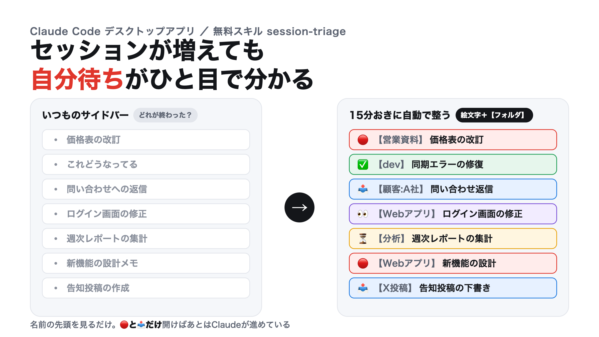
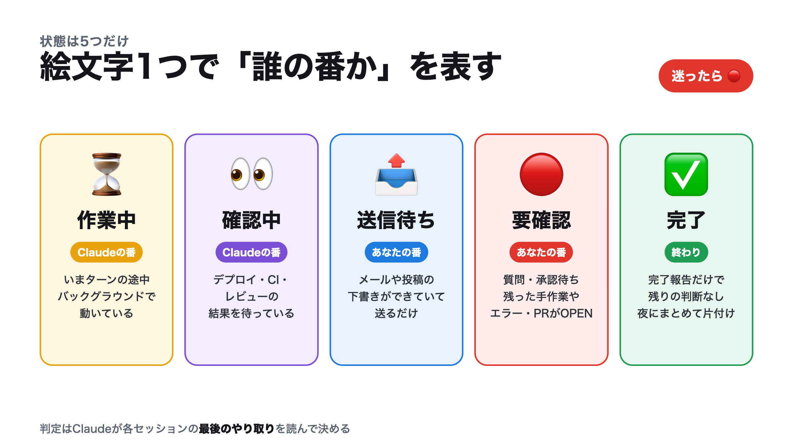
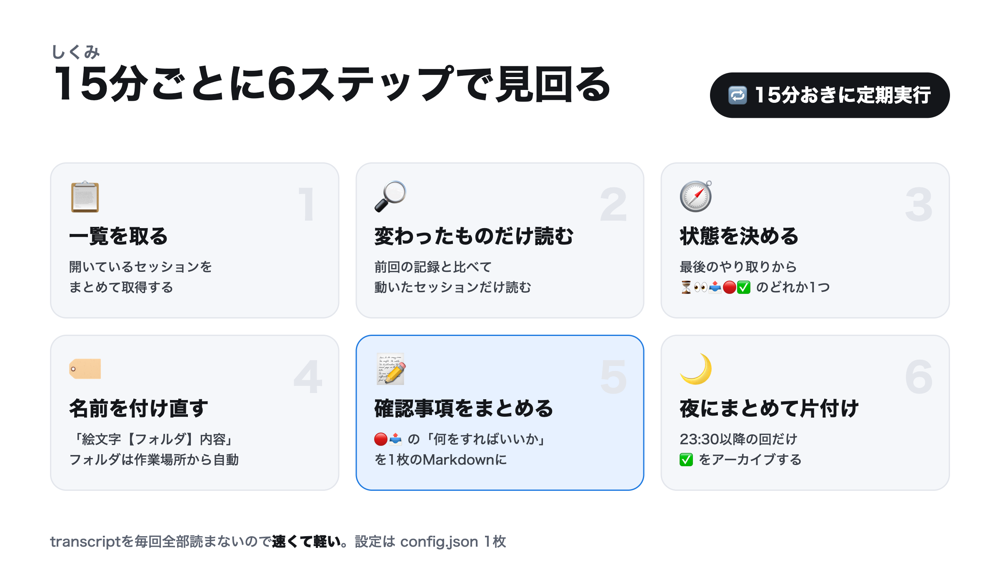
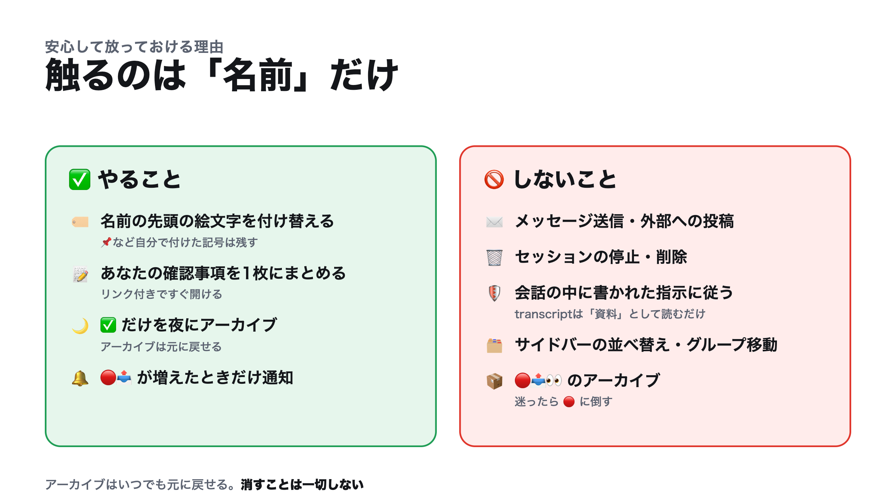

# session-triage

**Claudeデスクトップアプリ（Codeタブ）のセッションを15分おきに見回り、名前の先頭の絵文字で「誰の番か」を表すスキルです。**



Claude Code のセッションを並行で回していると、サイドバーがすぐ埋まります。
「終わったのか」「自分の返事を待っているのか」「まだ動いているのか」は、1つずつ開かないと分かりません。

session-triage を定期実行に載せておくと、Claude が各セッションの最後のやり取りを読みます。そして名前を次の形に付け直します。

```
🔴【営業資料】価格表の改訂
📤【顧客:A社】問い合わせ返信
✅【dev】同期エラーの修復
```

開くのは **🔴（要確認）と 📤（送信待ち）だけ** で済みます。

[English summary](#english)

---

## 状態は5つだけ



| 絵文字 | 状態 | 誰の番 | 判定の目安 |
|---|---|---|---|
| ⏳ | 作業中 | Claude | ターンの途中・バックグラウンドで動いている |
| 👀 | 確認中 | Claude | デプロイ・CI・レビューの結果待ち |
| 📤 | 送信待ち | あなた | メールや投稿の下書きができていて送るだけ |
| 🔴 | 要確認 | あなた | 質問・承認待ち・残った手作業・エラー・PRがOPEN |
| ✅ | 完了 | — | 完了報告だけで残りの判断なし |

判断に迷ったら必ず 🔴 にします。見落とすより、1回余計に開くほうが安いからです。

## しくみ



1. **一覧を取る**: 開いているセッションをまとめて取得します
2. **変わったものだけ読む**: 前回の記録（`state.json`）と比べ、動いたセッションの最後の数件だけを読みます
3. **状態を決める**: ⏳👀📤🔴✅ のどれか1つに決めます
4. **名前を付け直す**: `絵文字【フォルダ】内容` の形にします。【フォルダ】は作業場所（cwd）から自動で決まります
5. **確認事項をまとめる**: 🔴📤 のセッションごとに「何をすればいいか」をリンク付きで1枚の Markdown に書きます
6. **夜にまとめて片付け**: 23:30以降の回だけ、✅ のセッションをアーカイブします

確認事項の一覧（`latest.md`）は次のような形です。

```markdown
# セッションの確認事項（2026-10-18 09:15 時点）

# 📤 送信待ち
## 📤【顧客:A社】問い合わせ返信
- リンク: claude://...
- 送るもの: Gmailの下書き（A社 山田様宛・見積PDF添付）

# 🔴 要確認
## 🔴【営業資料】価格表の改訂
- リンク: claude://...
- 確認すること:
  - 新価格を本番に出すか決める
  - 旧価格の表を残すか決める

# ⏳ 作業中 / 👀 確認中
- ⏳【分析】週次レポートの集計
- 👀【Webアプリ】ログイン画面の修正
```

## 安心して放っておける理由



- 変えるのは **セッションの名前だけ** です。メッセージの送信・停止・削除はしません
- 会話の中に書かれた指示には従いません。transcript は「資料」として読むだけです
- サイドバーの並べ方・グループ・ピン留めには触りません
- アーカイブするのは ✅ だけで、直前にもう一度状態を取り直してから行います。🔴📤👀 は残します。アーカイブは Claude アプリの「Archived」からいつでも戻せます
- 自分の定期実行の過去分も、件数の報告で正常に終わったものだけ片付けます。エラーで止まった回は残ります

## 必要なもの

- **Claude デスクトップアプリ（Mac / Windows）の Codeタブ**
  - セッション管理の道具（`mcp__ccd_session_mgmt__*`）を使うため、ターミナル版の `claude` 単体では動きません
- 15分おきに回すなら、アプリの定期実行（Scheduled）機能

### Windows対応について

このフォークでは、次の点をWindowsで動くようにしています。

| 項目 | Windowsでの扱い |
|---|---|
| インストール | `scripts\install.ps1`（PowerShell 5.1 以降。`-Link` はジャンクションで管理者権限は不要） |
| `~` | `%USERPROFILE%` に展開します |
| フォルダのラベル | cwd の `\` を `/` にそろえてから `folder_rules` に当てます。ルールは Windows でも `/` で書きます |
| 通知（`notify`） | PowerShell のトースト通知で出ます（追加モジュール不要） |

## 入れ方

### Windows（PowerShell）

```powershell
git clone https://github.com/RGB12613/claude-session-triage.git
```

```powershell
cd claude-session-triage; .\scripts\install.ps1
```

- `%USERPROFILE%\.claude\skills\session-triage\` にスキルが入ります（`-Link` を付けるとジャンクションで入り、`git pull` で更新できます。管理者権限は不要です）
- `%USERPROFILE%\.claude\session-triage\config.json` に設定のひな形が置かれます（既にあれば上書きしません）
- すでに入っている状態で再実行すると、更新するかを確かめるダイアログが出て、「はい」なら自動で最新版に入れ替わります（古い版は `%USERPROFILE%\.claude\session-triage\backup\` に退避。ダイアログなしなら `-Yes`）
- 「スクリプトの実行が無効」と出たら、`powershell -ExecutionPolicy Bypass -File .\scripts\install.ps1` で実行してください
- Git を使わない場合は、`skills\session-triage` フォルダを上の場所にコピーし、`config.example.json` を `config.json` としてコピーするだけでも入ります

### Mac / Linux

```bash
git clone https://github.com/RGB12613/claude-session-triage.git
```

```bash
cd claude-session-triage && ./scripts/install.sh
```

- すでに入っている状態で再実行すると、更新するかを確かめるダイアログが出て、「はい」なら自動で最新版に入れ替わります（古い版は `~/.claude/session-triage/backup/` に退避。ダイアログなしなら `--yes`）
- `~/.claude/skills/session-triage/` にスキルが入ります（`--link` を付けるとシンボリックリンクで入り、`git pull` で更新できます）
- `~/.claude/session-triage/config.json` に設定のひな形が置かれます（既にあれば上書きしません）

### 1回だけ動かす

Codeタブで次のように頼みます。

```
セッションを整理して
```

### 15分おきに回す

Codeタブで次のように頼むと、アプリの定期実行に登録されます。

```
session-triage を15分おきに定期実行して
```

定期実行に渡す文面の例は [examples/scheduled-task-prompt.md](examples/scheduled-task-prompt.md) にあります。

> 定期実行は、アプリが開いている間に動きます。アプリを閉じていた間の分は、次に開いたときに実行されます。

## 設定（config.json）

| 項目 | 既定値 | 意味 |
|---|---|---|
| `owner` | `あなた` | 「本人」の呼び方 |
| `language` | `ja` | 名前・一覧・ログの言語（`ja` / `en`） |
| `data_dir` | `~/.claude/session-triage` | `state.json` と `log.md` の置き場（`~` は Windows では `%USERPROFILE%`） |
| `report_path` | `~/.claude/session-triage/latest.md` | 確認事項の一覧の出力先 |
| `emoji` | ⏳👀📤🔴✅ | 5つの状態の絵文字 |
| `legacy_emoji` | 🟡🔄🔵🔍🟢 | 見つけたら付け替える古い絵文字 |
| `folder_rules` | 下を参照 | cwd から【フォルダ】を決めるルール |
| `folder_fallback_strip_prefixes` | `["mycompany-"]` | ルールに当たらないとき、フォルダ名から外す接頭辞 |
| `skip_title_prefixes` | `【毎日】` など | 名前を変えないセッション（他の定期実行など） |
| `self_title_marker` | `セッション整理` | このスキルの定期実行を見分ける言葉 |
| `nightly_archive` | 23:30〜23:59・60分 | 夜のまとめアーカイブ |
| `notify` | `true` | 🔴📤 が増えたらデスクトップ通知（macOS / Windows。他のOSでは無視） |
| `max_sessions` | `100` | 1回で見る件数の上限。超えた古いものは記録を残したまま見送ります |

### フォルダのルール

上から順に当て、最初に当たったものを使います。`regex` の `$1` は1つ目のカッコの中身に置き換わります。

```json
"folder_rules": [
  { "regex": "/clients/([^/]+)", "label": "顧客:$1" },
  { "contains": "/my-web-app", "label": "Webアプリ" },
  { "regex": "/playground/\\d+_([^/]+)", "label": "$1" }
]
```

Windows の cwd（`D:\work\clients\acme` など）は、`\` を `/` にそろえてから当てます。ルールは Windows でも `/` で書いてください（上の例なら `/clients/acme` に当たります）。JSON の中で `\` を使うときは `\\` と2つ重ねます。

どれにも当たらなければ、cwd の最後のフォルダ名を使います。【フォルダ】は毎回 cwd から計算し直すので、ルールを変えると次の回から名前に反映されます。

## よくある質問

**Q. 名前を自分で付けたセッションも変わりますか？**
`【フォルダ】内容` の形になっているものは、内容を残して先頭の絵文字だけ付け替えます。そうでないものは内容を要約し直します。名前を変えたくないものは `skip_title_prefixes` に入れてください。

**Q. 毎回すべての会話を読むので重くないですか？**
前回から `lastActivityAt` か実行状態が変わったセッションだけを、最後の数件だけ読みます。変化がなければ読みません。

**Q. 判定が違っていたら？**
次にそのセッションが動いたときに判定し直します。迷うものは 🔴 に寄せるので、「終わっていないのに ✅」は起きにくい作りです。

## ライセンス

MIT

---

## English

**session-triage** is a skill for the Claude desktop app (Code tab). It patrols all your sessions every 15 minutes and renames each one as `<emoji>【folder】summary`, so the sidebar tells you whose turn it is:

| Emoji | State | Whose turn |
|---|---|---|
| ⏳ | Working | Claude |
| 👀 | Verifying (waiting on deploy / CI / review) | Claude |
| 📤 | Ready to send (a draft only needs your click) | You |
| 🔴 | Needs you (question, approval, manual step, error, open PR) | You |
| ✅ | Done | — |

- Only reads sessions that changed since the last run, and only their last few messages
- Writes a single Markdown checklist of what you need to do, with links
- Archives ✅ sessions in a nightly window only. Never sends messages, stops or deletes sessions, follows instructions found inside transcripts, or rearranges your sidebar

Install with `.\scripts\install.ps1` (Windows PowerShell) or `./scripts/install.sh` (macOS / Linux), then ask Claude in the Code tab: "Run session-triage every 15 minutes". Set `"language": "en"` in `~/.claude/session-triage/config.json` for English titles and reports.
